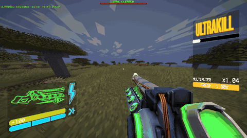
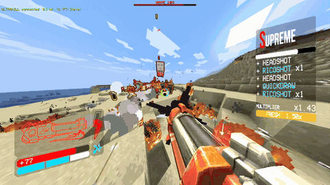

# Cybergrind for Minecraft



[](https://www.youtube.com/watch?v=eWu_tSvfp5c)

*Click the picture for the full showcase on YouTube.*

ULTRAKILL's **Cyber Grind** as a Minecraft mod: endless, escalating waves of Minecraft mobs around you, with bosses, special
enemies and a settings menu. Made to be played as **V1** with the
[ULTRAKILL x Minecraft](https://github.com/xandermodsstuff-dot/ultrakill-minecraft) mod, and it works as plain Steve too.

- **Endless waves.** Each wave gets a bigger budget of enemies, tougher enemies unlock as you go, and every 5th wave is a big one.
  You get a 5-second break and some regeneration between waves.
- **23 kinds of enemies in 5 tiers, plus 3 bosses**, including custom variants:
  - **Juggernaut**, an oversized, armoured zombie.
  - **Blade**, a sword skeleton.
  - **Phantom**, a spider that blinks behind you.
  - **Bomber**, a charged creeper.
  - **Volley** and **Gunner**, rapid-fire archers.
  - **Ghasts** that hunt you with big, fast fireballs.
- **Bosses every 5th wave from wave 10**: Iron Golem, Warden and Wither in turn, with one more of each every cycle.
  - The **Warden** slams the ground when you're close.
  - The **Iron Golem** leaps at you.
  - The **Wither** calls wither skeletons at half health.
  - **Ravagers** (not a boss) charge-dash at you.
- **Enemies built to keep up with V1:** they're faster with every wave, jump 6-8 blocks, never burn in daylight, spiders attack in
  daylight too, and enemies never target each other.
- **Radiant enemies** from wave 10: tougher and faster, with a gold outline.
- **Armor that scales with the wave**, shown on your armor bar. It's removed when the run ends and never saved to your player.
- **No status-effect cheese:** no poison, slowness, weakness, wither or darkness on you during a run. Witches only throw Harming.
- **A wave HUD:** boss bar, wave titles, a raid horn, armor-upgrade messages, and a red particle wall around the arena.
- **Your own run music**: drop songs in a folder, then shuffle them or pick which ones play (see [Music](#music)).
- **A settings menu**, opened with **K** or from the pause menu.



## Requirements

- **Minecraft: Java Edition 26.3** with **Fabric Loader** 0.19.3 or newer and **Fabric API** for 26.3.
- **Java 25**, which the Minecraft launchers provide.
- **Single-player only.**
- Optional but Highly Recommended: **[ULTRAKILL x Minecraft](https://github.com/xandermodsstuff-dot/ultrakill-minecraft)** 0.1.2. With it, a V1 death
  ends the run instantly, and the menu has a button for that mod's settings, including Progression Mode.

## Installing

1. Install Fabric Loader and Fabric API for 26.3, the same way as for any Fabric mod.
2. Download `cybergrind-<version>.jar` from the [Releases](../../releases) page and put it in your `mods` folder.
3. Start Minecraft, open a single-player world, and press **K**.

To uninstall, delete the jar. Your settings are kept in `config/cybergrind.json`, and each world's best wave in that world's
folder (`cybergrind.json`).

## Playing

Press **K**, or press **Esc** and click **Cybergrind...**, to open the menu. The key can be changed in Options → Controls →
Cybergrind.

| Menu option | What it does |
|---|---|
| **Mob Drops** | Loot from arena enemies. XP drops either way. |
| **Run Music** | Your own songs during a run (see [Music](#music)). |
| **End on Death** | **On:** dying (V1 or Steve) ends the run at once. **Off:** the run goes on, and you're brought back to the arena after respawning. |
| **Arena Wall** | **On:** a red ring around where you started, and 5 seconds outside it ends the run. **Off:** no wall, waves spawn around you, and enemies that fall far behind come back to you. |
| **Enemy Outlines** | Always / only for a wave's last 5 enemies / off. |
| **Starting Wave** | 1-999. Type it or use the buttons. |
| **Max Enemies per Wave** | 5-100. Bosses come on top. Lower runs smoother. |
| **Spawn Radius** | 8-40 blocks. The wall is 4 blocks further out. |
| **Music...** | Pick, order and shuffle your songs (see [Music](#music)). |
| **ULTRAKILL Settings...** | Opens the ULTRAKILL x Minecraft mod's settings, including Progression Mode (needs that mod). |
| **START / STOP** | Start a run where you stand, or end it. **Skip Wave** clears the current wave. |

Commands: `/cybergrind start`, `/cybergrind stop`, `/cybergrind skip`.

Difficulty must be Easy or higher. Creepers, Bombers, ghasts and the Wither break terrain, so play somewhere you don't mind
losing.

## Music

**No music comes with this mod.** Add your own songs and they play during runs in place of Minecraft's music.

1. Open the menu (**K**) → **Music...** → **Open Folder**. That's the `cybergrind-music` folder in your Minecraft folder.
2. Put your songs in it as **`.ogg` (Ogg Vorbis)** files. To convert `.mp3`, `.wav` or `.flac`, use
   [Audacity](https://www.audacityteam.org/) (File → Export Audio → Ogg) or any converter.
3. Click **Rescan**. Your songs show up in the list.

In the **Music...** screen:

| Control | What it does |
|---|---|
| **ON / OFF** next to a song | Choose which songs play. New songs start ON. |
| **▲ / ▼** | Change the order of the list. The order is saved. |
| **Shuffle** | **On:** random order, never the same song twice in a row. **Off:** plays the list top to bottom, then starts over. |
| **Next Song ▶** | Skip to another song during a run. |
| **Open Folder / Rescan** | Add or remove songs without restarting the game. |

A single song loops. The music follows Minecraft's **Music** volume slider, and **pauses while the Esc menu or the Cybergrind
menu is open**, picking up where it left off when you close it. The inventory and chat don't pause it. **Run Music** in the
main menu turns it all off.

You can also use a resource pack: `assets/cybergrind/sounds/music.ogg`, plus an optional `intro.ogg` played first. It shows up
in the list as "Cyber Grind (resource pack)".

Only use music you have the right to use, and please don't share other people's music with the mod.

## Known issues

- Ground fires from ghast and blaze fireballs can still burn enemies.
- Explosions from Bombers and evoker fangs still hurt other enemies.
- Mobs only jump when their pathfinding needs to, so they can't jump up to V1 in mid-air. An enemy stuck on terrain can be cleared with Skip Wave or by moving far away.

## Planned Features
- Difficulty Modes
- Porting over the Ultrakill enemies to Minecraft with the same logic.
- Vanilla Enemy Types
- Drops/Pickups such as Double Weapons/Health etc.
- Custom Arena/Radius Wall
## Reporting a bug

Open an [issue](../../issues) and say what you did and what went wrong. Attach Minecraft's `logs/latest.log`.

## Building

```bash
./gradlew build
```

The jar is written to `build/libs/`. Building needs JDK 25. The Gradle wrapper downloads Gradle 9.7.1 and Fabric Loom on the
first build.

## Credits

- Made by somegoodstew.
- Written with [Claude Code](https://claude.com/claude-code) (Anthropic's Claude) as the programmer.
- [Fabric](https://fabricmc.net) (Loader, API, Loom) and [Mixin](https://github.com/SpongePowered/Mixin).
- The pause-menu button placement follows the [ULTRAKILL x Minecraft](https://github.com/xandermodsstuff-dot/ultrakill-minecraft)
  mod (MIT) by xandermodsstuff-dot, so both buttons stack.
- ULTRAKILL and the Cyber Grind belong to Arsi "Hakita" Patala and New Blood Interactive, and Minecraft belongs to Mojang Studios
  and Microsoft. This is a fan project, not made or endorsed by any of them. No game files, decompiled code or music are part of
  it.

## License

The code is under the [MIT License](LICENSE).
